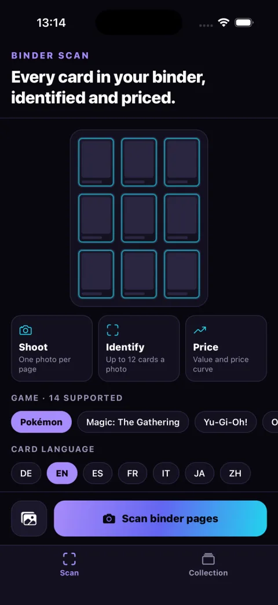
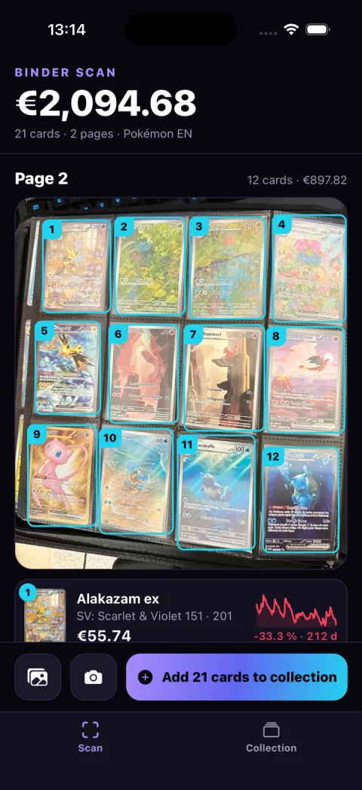
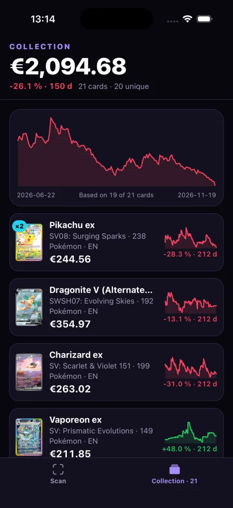

# Binder Scan

A small Expo app built on the [ValoTCG APIs](https://valotcg.com/developers), with two tabs:

- **Scan**: photograph a binder page by page and get every card identified, priced, and charted, with a running total for the whole binder.
- **Collection**: add the scanned cards in one tap, then follow the value of the collection, its curve over time, and each card's price history.

<p>
  
  
  
</p>

The app was built with an AI coding agent. The prompts and the rules the agent followed are in the guide [Build a card scanner and collection app with an AI agent](https://valotcg.com/developers/guides/build-a-card-app-with-an-ai-agent).

- **Valo.Vision** identifies up to 12 cards in one photo and returns where each one is on it (`POST /vision/v1/scans/multi`).
- **Valo.Data** lists the supported games (`GET /data/v1/games`), returns the current price of the cards in one call (`POST /data/v1/analysis/compare`, the recommended price in EUR) and the daily price history of each card (`GET /data/v1/cards/{card_id}/price-history`).

The whole API layer is in [`src/api.ts`](src/api.ts), about 100 lines.

## Run it

You need Node 20+, a ValoTCG API key with a Valo.Vision plan (a free trial is available from the [developer portal](https://valotcg.com/developers)), and either an iOS simulator or a phone with Expo Go.

```bash
npm install
cp .env.example .env   # then set VALO_API_KEY
npm run proxy          # terminal 1: adds the key to the requests
npx expo start         # terminal 2: press i for the simulator, or scan the QR code with your phone
```

Choose the game and the language of the cards, then photograph the pages one after the other, or pick photos from the library (the simulator has no camera: drag images onto its window to add them). "Add cards to collection" moves them to the Collection tab.

The collection is stored in a JSON file on the phone ([`src/collection.ts`](src/collection.ts)). Its prices refresh when it is opened more than 24 hours after the last refresh, or when you pull down. The value curve adds up the cards that have a price history and says on how many cards it is based.

On a phone, the app reaches the proxy on the computer that serves the bundle, so both must be on the same network.

## Why a proxy

An API key shipped inside a mobile app can be extracted from the bundle. The app therefore calls [`server/proxy.mjs`](server/proxy.mjs), a 40-line Node server that adds the key and forwards the request to `api.valotcg.com`. In production, put that logic behind your own authentication.

## What it costs

One page of 9 identified cards uses 9 scans (one per matched or ambiguous card, at least one per photo), 1 credit for the prices of up to 10 cards, and 3 credits per price history. Listing the games is free. Refreshing a collection costs the same price and history credits again, which is why the app does it once a day at most.

## License

MIT
